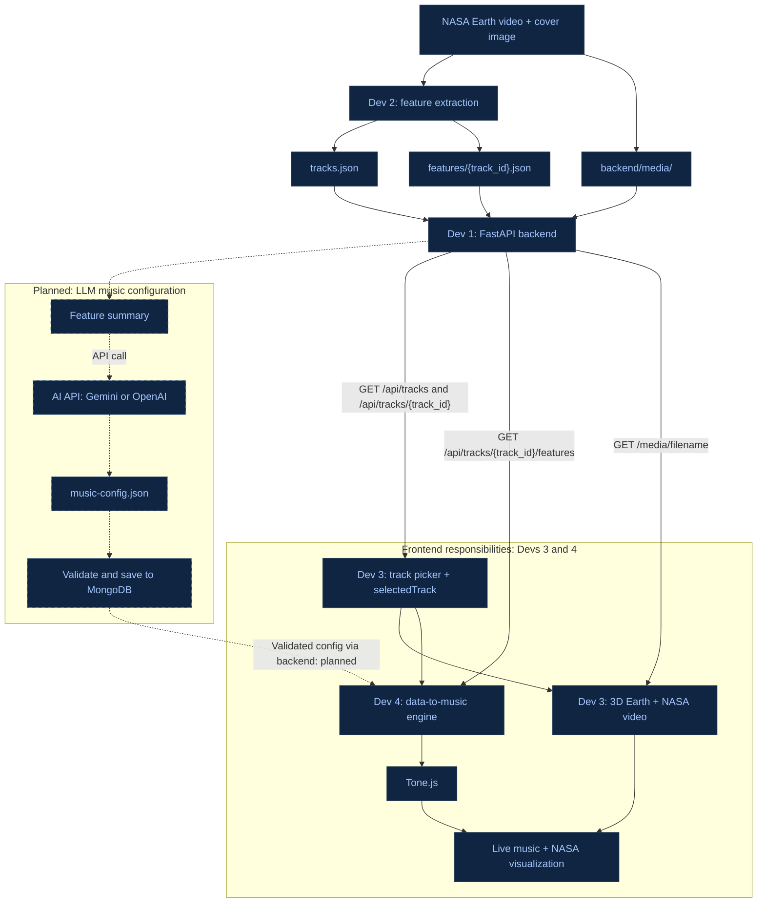

# How it all works

## The big picture

The backend currently serves track metadata, timed features, and media files.
The diagram also shows the planned LLM configuration flow and the frontend pieces
owned by Devs 3 and 4. Dashed boxes and arrows mark the planned LLM/database work.



The engine receives both the original timed features and, once implemented, a
validated music configuration. The summary/configuration flow does not replace
the per-frame features used during playback.

## The shared data

1. **`backend/data/tracks.json`** contains a list of tracks. Each track has `id`,
   `title`, `cover`, `video`, and `duration` in seconds. It contains
   metadata only; music settings are kept separate.
2. **`backend/data/features/{track_id}.json`** contains a time-ordered array of
   samples. Each sample has `t` in seconds and the agreed features: `brightness`,
   `motion`, `color`, and `contrast`. The agreed interval is 2 seconds.
   Brightness, motion, and contrast are 0–1. `color` contains seven proportions:
   `red`, `yellow`, `green`, `cyan`, `blue`, `magenta`, and `neutral`, totaling 1.
3. **Media files** live in `backend/media/` and are served at `/media/<filename>`.
4. **`music-config.json` (planned)** represents the LLM-generated music settings.
   It will be validated and persisted in MongoDB. Its exact schema, whether a JSON
   file is also retained, and the API for retrieving it remain to be agreed.

Track IDs and feature filenames must match. The real `ecco2_sst_flow` track has
34 samples at two-second intervals. It currently references external NASA media;
local video and cover downloads are deferred. See
[`backend/data/README.md`](../backend/data/README.md) for the current data contract
and [`Agent.md`](../Agent.md) for the completed Dev 1 work.

## Planned LLM API flow

1. The backend reads a track and its timed features and creates a compact feature
   summary, such as average values and how they change over time.
2. The backend calls a selected LLM provider: Gemini or OpenAI.
3. The LLM returns a proposed music configuration, separate from track metadata.
4. The backend validates that configuration against an agreed schema and saves
   the accepted result to MongoDB, linked to the track ID.
5. The frontend receives the saved configuration through a future backend API.
   Dev 4's engine combines it with the original timed features to drive Tone.js.

Generate and save the configuration when preparing a track, rather than making
an LLM request for every playback frame. The existing three track endpoints still
serve local JSON; no LLM calls, configuration endpoint, or MongoDB persistence are
implemented yet. Playback with a new configuration and any fallback behavior must
be agreed with Dev 4 before integration.

## What happens when a user plays a track

This is the target frontend flow; the current frontend has a basic audio prototype.

1. The page calls `GET /api/tracks` to get the track list.
2. The user selects a track. The frontend calls `GET /api/tracks/{track_id}` and
   `GET /api/tracks/{track_id}/features`.
3. Dev 3 loads the track's `video` URL and wraps it around the globe. Local media
   uses `/media/...`; the current track still references NASA-hosted media.
4. Once the LLM flow is implemented, the frontend also loads its saved music
   configuration through the backend; that endpoint is not defined yet.
5. The user presses Play. Dev 4's player starts audio and the shared video element
   together.
6. During playback, the engine reads features at the current time and uses them
   to shape the music. The generated configuration will provide musical settings.
7. Dev 4 owns play, pause, seeking, and audio/video synchronization. Style or
   instrument controls are frontend work and do not add music fields to tracks.

## Order of work

| Day | Goal |
|---|---|
| 1 | Hello world runs for everyone. Agree on the JSON shapes. Fake example data is in. |
| 2 | Everyone builds their piece against the fake data. |
| 3 | Swap in the real NASA track. Make it play end to end. |
| 4 | Polish, plus planned LLM-generated music configuration, MongoDB persistence, and more tracks. |

Dev 1's track endpoints and media serving are implemented and merged. Real JSON
data is integrated on `API/real-track-data`; local media integration and the
LLM/database flow remain separate work.

## Who blocks whom (Day 1 first 2 hours = all together)

```
Dev 2 (video choice, feature names) ──► Dev 1 (JSON shape + URLs) ──► Dev 3 (App state, videoRef) ──► Dev 4 (play/sync)
                         └────────────── feature names/ranges ──────────────────────────────────────► Dev 4
```

**Decide together before splitting up:** (1) the NASA video, (2) the JSON shapes and one fake example, (3) the URLs, (4) `selectedTrack` + `videoRef` in App.jsx, with Dev 4 owning play.

**Before adding LLM configuration:** Devs 1 and 4 agree on the music-config schema
and retrieval API; Devs 1 and 2 agree on how to summarize the extracted features.
