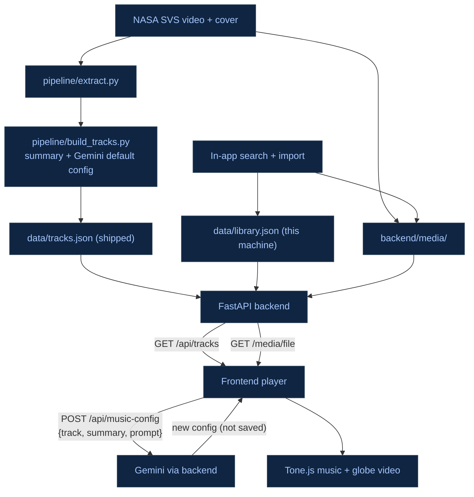

# How it all works

## The big picture

Every track is one JSON object with everything the player needs: metadata, timed
features, a feature summary, and a default music style. The backend serves those
objects and the media files; the frontend turns features plus style into Tone.js
notes in sync with the NASA video on the globe. Gemini is called only offline (to
make a default style) or when the user asks for a new vibe.

## The shared data

- **`backend/data/tracks.json`** is the catalog shipped with the repo.
- **`backend/data/library.json`** (ignored by git) holds tracks imported on this
  machine, in the same shape.
- **Media** lives in `backend/media/` and is served at `/media/<filename>`.
  Imported media is named `svs{nasa_id}.*` and ignored by git.

Each track has `id`, `title`, `description`, `cover`, `video`, `duration`,
`nasa_id`, `source`, plus:

- `features`: one sample per second with whole-frame `brightness`, `motion`,
  `color`, `contrast`, and a latitude × longitude `grid` (presence, temperature,
  current speed, flow direction).
- `summary`: a compact summary of `features`, sent to Gemini instead of the
  full features.
- `config`: the default music style. If it is missing, the player uses its
  built-in default, so playback never needs Gemini.

See [`backend/data/README.md`](../backend/data/README.md) for the exact contract
and [the music-config guide](../backend/MUSIC_CONFIG.md) for the style schema.

## Adding a track

**Offline (shipped catalog):**
1. `pipeline/extract.py <video> <track_id>` writes features into `tracks.json`.
2. `pipeline/build_tracks.py` computes each summary and asks Gemini for a
   default config where one is missing.

**In the app (this machine only):**
1. The search bar calls `GET /api/search?q=…`. The backend queries the SVS API
   and keeps results with a downloadable movie.
2. Clicking a card calls `POST /api/imports`. A background worker downloads the
   movie and thumbnail, extracts features, computes the summary, asks Gemini
   for a default config (falling back to none), and appends the track to
   `library.json`. The frontend polls `GET /api/imports/{job}` for progress.
3. When the job is done the track list refreshes and the new track plays.
   Imported tracks can be removed with `DELETE /api/tracks/{id}`.

## Changing the vibe

The user picks a preset or types a mood. The frontend sends the track metadata,
its `summary`, and the prompt to `POST /api/music-config`. The backend calls
Gemini, validates the result against the schema, and returns it. Nothing is
saved; the API key stays in `backend/.env` and never reaches the browser.

## What happens when a user plays a track

1. The page calls `GET /api/tracks` to get every track.
2. The user selects a track; its features and default config are already loaded.
3. The track's `/media/...` video is wrapped around the globe.
4. On play, the engine precomputes every note from the features and style, then
   starts the Tone.js transport and the video together.
5. The globe turns so the longitude being played faces the viewer. A scan line
   marks it, a marker on each latitude band pulses when that band plays, and the
   atmosphere and aurora follow the music's loudness.
6. Pause, seek, volume, and track changes keep audio and video together; the
   video follows the audio clock.
