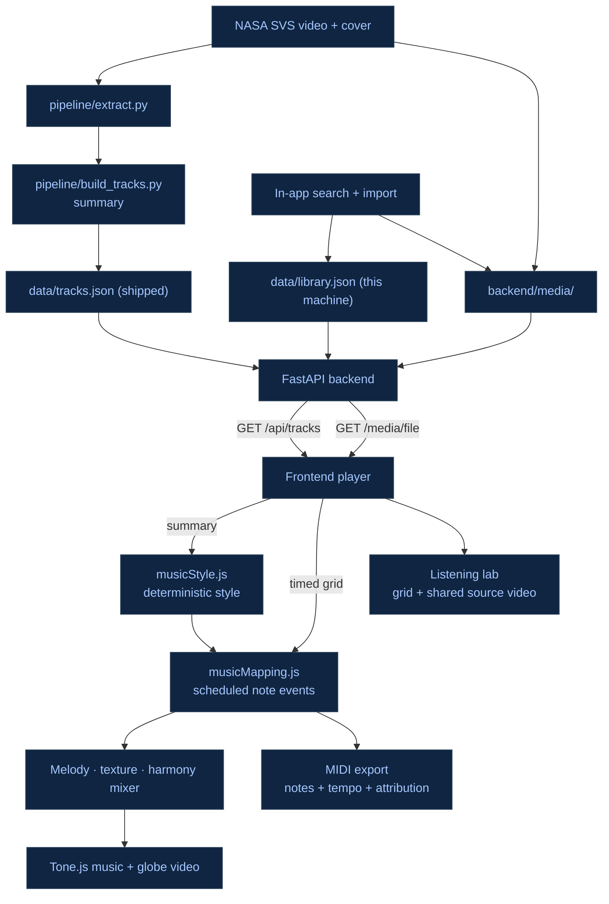

# How it all works

## The big picture

Every track is one JSON object with everything the player needs: metadata, timed
features, and a feature summary. The backend serves those
objects and the media files; the frontend turns features plus style into Tone.js
notes in sync with the NASA video on the globe. The music style is derived in the
browser from each track's summary. Notes are generated locally at playback time;
no remote model call is needed.

## The shared data

- **`backend/data/tracks.json`** is the catalog shipped with the repo.
- **`backend/data/library.json`** (ignored by git) holds tracks imported on this
  machine, in the same shape.
- **Media** lives in `backend/media/` and is served at `/media/<filename>`.
  Imported media is named `svs{nasa_id}.*` and ignored by git.

Each track has `id`, `title`, `description`, `cover`, `video`, `duration`,
`nasa_id`, `source`, plus:

- `features`: one sample per second with whole-frame `brightness`, `motion`,
  `color`, `contrast`, and a latitude × longitude `grid` (presence, temperature,
  current speed, flow direction).
- `summary`: a compact summary of `features`, that the frontend derives
  the music style from.

See [`backend/data/README.md`](../backend/data/README.md) for the exact contract
and [the music-config guide](../backend/MUSIC_CONFIG.md) for the music mapping.

## Adding a track

**Offline (shipped catalog):**
1. `pipeline/extract.py <video> <track_id>` writes features into `tracks.json`.
2. `pipeline/build_tracks.py` recomputes each summary.

**In the app (this machine only):**
1. The search bar calls `GET /api/search?q=…`. The backend queries the SVS API
   and keeps results with a downloadable movie.
2. Clicking a card calls `POST /api/imports`. A background worker downloads the
   movie and thumbnail, extracts features, computes the summary, and appends the track to
   `library.json`. The frontend polls `GET /api/imports/{job}` for progress.
3. When the job is done the track list refreshes and the new track plays.
   Imported tracks can be removed with `DELETE /api/tracks/{id}`.

## Choosing the music style

The style (key, mode, tempo, instruments) is derived deterministically in the
frontend by `frontend/src/services/tone/musicStyle.js` from the track's `summary`,
so the same track always sounds the same. Moods in the player are presets over
the same fields. No API key or network call is involved.

## What happens when a user plays a track

1. The page calls `GET /api/tracks` to get every track.
2. The user selects a track; its features and summary are already loaded.
3. The track's `/media/...` video is wrapped around the globe.
4. On play, the engine precomputes every note from the features and style, then
   starts the Tone.js transport and the video together.
5. The globe turns so the longitude being played faces the viewer. A scan line
   marks it, a marker on each latitude band pulses when that band plays, and the
   atmosphere and aurora follow the music's loudness.
6. Pause, seek, volume, and track changes keep audio and video together; the
   video follows the audio clock.
7. The listening lab visualizes the same sampled grid and source video. Its
   faders control separate audio buses, and a map click seeks to a matching scan
   longitude. MIDI export uses the same note generator and current mix.

Color-derived warmth and optical flow are normalized visual measurements, not
physical °C or m/s. Brightness, contrast, and whole-frame motion remain stored
but do not drive the current music. The spatial grid assumes an equirectangular
world map.
