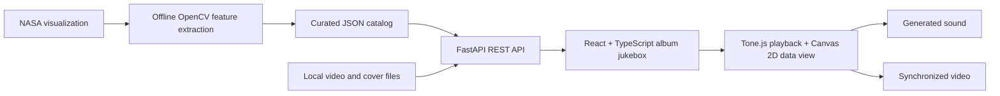

# How it works

## Architecture



The browser does not analyze videos when someone visits the site. OpenCV
precomputes feature samples during the offline pipeline; the frontend requests
the catalog once and requests a track's details and features when selected.
Album browsing is local after that first request. The app uses ordinary REST
requests and needs no WebSockets.

## Request and playback flow

1. The React app calls `GET /api/tracks`. The response contains only album-card
   metadata and cover URLs; video files and feature grids are not included.
2. Selecting an album calls `GET /api/tracks/{id}` and
   `GET /api/tracks/{id}/features`. FastAPI reads the curated JSON catalog.
3. The browser loads the selected local video from `/media/...` and presents
   its controls alongside a Canvas 2D view of the measured data.
4. On Play, Tone.js schedules notes and chords from the selected feature
   timeline. Its audio transport is the master clock; the video follows it.
5. Whole-frame brightness or color maps to pitch, latitude to tone color and
   harmony, current speed to rhythm and loudness, and flow direction to stereo
   pan. The scan's presence-weighted mean latitude selects the chords.

The Canvas visualizer draws the precomputed latitude/longitude grid and marks
the column currently being sonified. It is a 2D data display, not a 3D globe.

## Track data and assets

- `backend/data/tracks.json` is the curated catalog. It stores track metadata,
  precomputed features, a compact summary, and the default music style.
- `backend/media/` contains the local videos and cover images served by FastAPI.
  Local hosting supports same-origin playback and seeking.
- Each feature sample contains whole-frame image measurements and an 8 × 24
  grid of `[presence, temperature, speed, flow]` values.

See [the exact contract and routes](../backend/data/README.md).

## Preparing a track

Use the offline pipeline to extract measurements from a local video and build
the summary and default style:

```bash
backend/.venv/bin/python backend/pipeline/extract.py \
  backend/media/your-video.mp4 your-track-id --nasa-id 1234
backend/.venv/bin/python -m backend.pipeline.build_tracks
```

The optional Gemini call happens only in this offline build step. The app uses
the stored style; it does not call an AI provider during browsing or playback.
