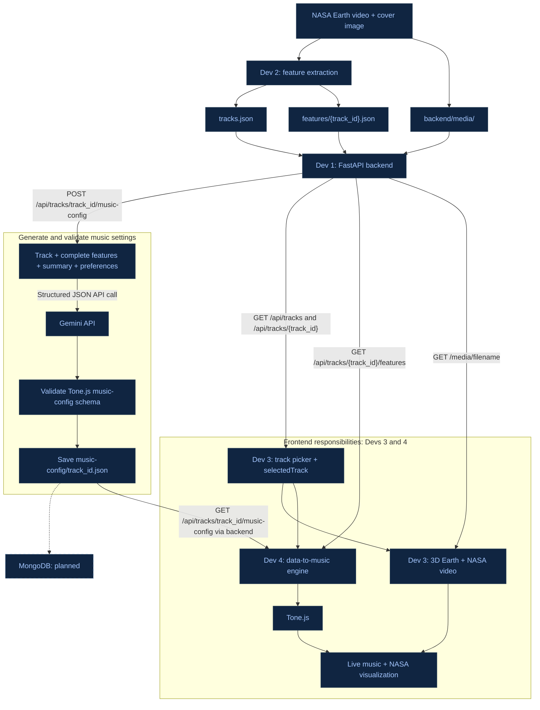

# How it all works

## The big picture

The backend serves track metadata, timed features, media files, and validated
music configs generated with Gemini. The frontend combines the config and raw
features to schedule Tone.js notes. MongoDB remains planned; configs currently
live in local JSON files. Dashed boxes and arrows mark planned database work.



The engine receives both the original timed features and a saved, validated
music configuration. The summary/configuration flow does not replace
the per-frame features used during playback.

## The shared data

1. **`backend/data/tracks.json`** contains a list of tracks. Each track has `id`,
   `title`, `cover`, `video`, and `duration` in seconds. It contains
   metadata only; music settings are kept separate.
2. **`backend/data/features/{track_id}.json`** contains a time-ordered array of
   samples, one per second. Each sample has `t`, whole-frame `brightness`,
   `motion`, `color`, and `contrast`, plus a latitude × longitude `grid` whose
   cells hold presence, temperature, current speed, and flow direction.
3. **Media files** live in `backend/media/` and are served at `/media/<filename>`.
4. **`backend/data/music-config/{track_id}.json`** stores a validated config and
   source-data hash. The config contains tempo, a supported instrument, scale
   key, mode, tempo, instruments, timing, density, velocity, pad level, and reverb. The GET endpoint
   returns only the public config; MongoDB persistence remains planned.

Track IDs and feature filenames must match. The real `ecco2_sst_flow` track has
67 samples at one-second intervals, and its video and cover are served locally. See
[`backend/data/README.md`](../backend/data/README.md) for the current data contract
and [`Agent.md`](../Agent.md) for the completed Dev 1 work.

## Gemini API flow

1. The backend reads a track and its timed features and creates a compact feature
   summary, such as average values and how they change over time.
2. On an explicit Generate request, the backend calls Gemini with that summary,
   the track metadata, and optional musical preferences.
3. The LLM returns a proposed music configuration, separate from track metadata.
4. The backend validates supported instruments, pitch names, timing, tempo,
   ranges, and track ID, then atomically saves the accepted result to a local JSON
   file. Failed requests preserve any previous valid config.
5. The frontend receives the saved configuration through the music-config GET endpoint.
   Dev 4's engine combines it with the original timed features to drive Tone.js.

Generation is a separate POST action; selection and playback reuse saved settings.
The API key lives in `backend/.env` and is never sent to the browser. Missing keys,
provider failures, and invalid output appear as actionable errors. Changed source
data requires regeneration. See [the music-config guide](../backend/MUSIC_CONFIG.md)
for setup, the schema, and endpoint examples. MongoDB persistence is future work.

## What happens when a user plays a track

1. The page calls `GET /api/tracks` to get the track list.
2. The user selects a track. The frontend loads its features and saved style; with
   no saved style it uses the built-in default, so playback never needs Gemini.
3. Dev 3 loads the track's local `/media/...` video and wraps it around the globe.
4. The user presses play. The engine precomputes every note from the features and
   style, then starts the Tone.js transport and the video together.
5. The globe turns so the longitude being played faces the viewer. A scan line
   marks it, a marker on each latitude band pulses when that band plays, and the
   atmosphere and aurora follow the music's loudness.
6. Pause, seek, volume, and track changes keep audio and video together; the video
   follows the audio clock. See [the music-config guide](../backend/MUSIC_CONFIG.md)
   for the exact mapping.

## Order of work

| Day | Goal |
|---|---|
| 1 | Hello world runs for everyone. Agree on the JSON shapes. Fake example data is in. |
| 2 | Everyone builds their piece against the fake data. |
| 3 | Swap in the real NASA track. Make it play end to end. |
| 4 | Polish, plus planned LLM-generated music configuration, MongoDB persistence, and more tracks. |

Track endpoints, media serving, and real JSON integration are merged. Gemini music
config generation and playback integration are on `API/gemini-music-config`.
MongoDB remains separate work.

## Who blocks whom (Day 1 first 2 hours = all together)

```
Dev 2 (video choice, feature names) ──► Dev 1 (JSON shape + URLs) ──► Dev 3 (App state, videoRef) ──► Dev 4 (play/sync)
                         └────────────── feature names/ranges ──────────────────────────────────────► Dev 4
```

**Decide together before splitting up:** (1) the NASA video, (2) the JSON shapes and one fake example, (3) the URLs, (4) `selectedTrack` + `videoRef` in App.jsx, with Dev 4 owning play.

**Music-config contract:** Dev 1 validates the JSON schema and serves saved
settings; Dev 4's adapter maps its supported values to Tone.js. Keep the backend
schema, prompt, and frontend adapter aligned when extending instruments or timing.
